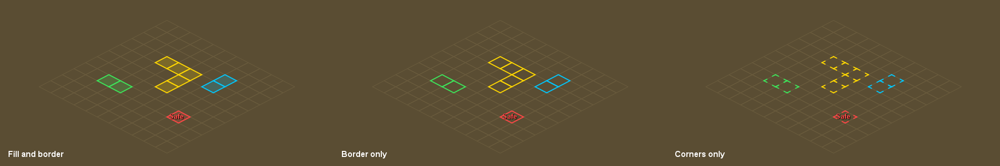

# Quick Tiles

Mark tiles without digging through menus. Point at a tile and press a key, or hold the key and sweep the mouse to paint a whole area.

## Marking tiles

- **Hotkey:** set a *Mark hotkey* in the plugin settings. Point at a tile and press it to mark it in your current colour.
- **Paint:** hold the hotkey and move the mouse. Every tile you pass over gets marked.
- **Erase:** start on a tile that already has your current colour, and the same key erases instead, as a tap or a sweep.
- **Recolour:** start on a tile of another colour to paint over it in your current colour.
- **Right-click:** *Mark tile* / *Unmark tile* is added to the ground's right-click menu, with no Shift needed. You can change this to Shift-only or off.
- **Shift + right-click** a marked tile to pick one of your colours, give it a label or a note, or put it in a group.

Tip: pick a key you don't type in chat, like a function key or a mouse button bound to a key. While the hotkey is held, its letter won't reach the chatbox.

## Ctrl shortcuts

Point at a tile, then press:

| Keys | Does |
|---|---|
| **Ctrl+Z / Ctrl+Y** | Undo / redo your last mark, paint stroke or area |
| **Ctrl+A** | Area: press on one corner, then on the other corner to mark the whole rectangle. Starting on a tile of your current colour erases instead. Esc cancels. |
| **Ctrl+S** | Line of sight: shades every tile with a clear line to that tile, using the game's own walls. It stays still until you press it on the same tile again, or click *Clear line of sight* in the sidebar. |
| **Ctrl+D** | Next colour |
| **Ctrl+G** | Next group for new tiles |

Right-click works exactly as before. Change any key in the sidebar (click **Change**, press the new key) or in the plugin settings.

## Groups and the sidebar

Click the Quick Tiles button in the sidebar to see:

- **Colour:** your 8 colours. Click one to mark in it.
- **Groups:** put tiles in named groups, e.g. one per boss. Click the dot to show or hide a group, click its name to put new tiles in it, and right-click it to rename, export or delete it. Each group shows how many tiles it has, and how many are around you.
- **Undo, Redo, Export and Import.** Export lets you pick: tiles around you, one group, or an area you choose with the area shortcut.
- **Hotkeys:** every shortcut, with a **Change** button.

Shift + right-click a marked tile to give it a label, a **note** (shown when you point at the tile), a group or a colour.

## Colours

There are eight colours, set in the *Colours* section. Press your *Next colour hotkey* to switch between them. A chat message shows which colour you're on.

## Show or hide

Press the *Show/hide hotkey* to hide every tile, e.g. for a clean screenshot, and press it again to bring them back.

## Styles

- Fill and border, border only, or corners only
- Fill opacity and border width
- Optional labels, minimap dots, and hiding the tile you're standing on

## Sharing and moving from Ground Markers

Right-click the world map orb next to the minimap:

- **Export Quick Tiles** copies the tiles around you to your clipboard.
- **Import Quick Tiles** adds tiles from your clipboard.
- **Copy Ground Markers to Quick Tiles** brings over every tile you marked with RuneLite's Ground Markers plugin. Your Ground Markers are left untouched.
- **Clear Quick Tiles** removes the tiles around you, after asking first.

Exports use the same format as Ground Markers, so tile packs shared on the wiki and Reddit paste straight in, and your Quick Tiles paste into Ground Markers too. Tiles exported from a group carry the group's name, so a friend importing them gets the same group.

Tiles are saved in your RuneLite profile, per map region, and work inside instances.
